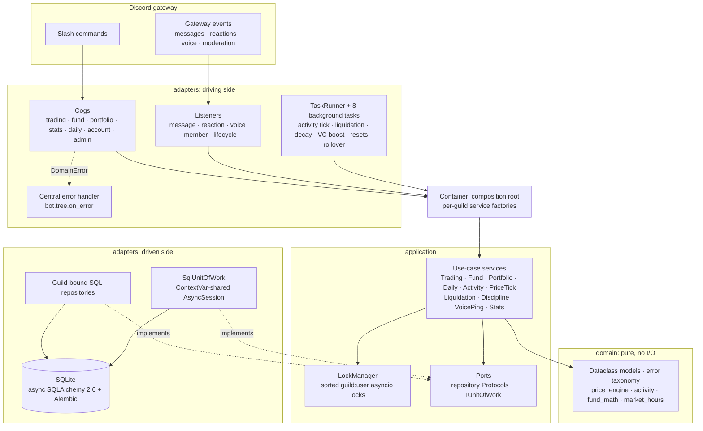

# Friendex

**A stock market where the stocks are your friends.** Friendex is a Discord bot that lists every
opted-in server member as a tradeable stock. The price moves with what that person actually does
in the server (messages, voice time, reactions, replies) and with what other members buy, sell,
short and cover.

[](https://github.com/z0rd0n88/friendex/actions/workflows/ci.yml)


[](https://github.com/astral-sh/ruff)
[](https://github.com/astral-sh/uv)


---

## What it is

Most Discord economy bots hand out points. Friendex runs a small market. Every server is its own
exchange, every member who opts in has a price, and that price comes from real engagement plus
real trading pressure. Being active pushes your stock up, going quiet lets it decay, and a
timeout from a moderator costs you 17%.

The project started as a single-file `bot.py` spec (kept in
[`docs/spec/original-skeleton.md`](./docs/spec/original-skeleton.md)). It was rebuilt from
scratch as a typed, tested, multi-tenant Python service with a **hexagonal (ports-and-adapters)
architecture**, **async SQLAlchemy 2.0 + Alembic**, and **1,128 automated tests**, including a
YAML-driven simulation of a whole Discord server.

### A few minutes in a Friendex server

```text
alice  ▸ /daily
Friendex ▸ Daily Reward · Reward: $500.00 · Streak: 1 · New balance: $10,500.00

alice  ▸ /buy user:@bob shares:10
Friendex ▸ Buy Confirmed
           Bought 10 share(s) of @bob at $100.00 each. Total cost: $1,000.00
           Cash balance: $9,500.00 · Price moved: $100.00 → $100.05

          ... bob posts, gets replies, sits in voice for 40 minutes ...
          ⏱ activity tick (every 15 min): ΔP = K · ln(1 + engagement score)

carol  ▸ /short user:@bob shares:20
Friendex ▸ Short Opened · collateral locked from cash (+ up to 50% of carol's hedge fund)
           position frozen for 30 min · short/cover cooldown 15 min

          ... bob keeps rallying; the price reaches 1.5× carol's entry ...
Friendex ▸ Short Position Liquidated
           @carol's short on @bob was auto-covered after the price crossed the
           liquidation threshold · Entry · Exit · P&L · Collateral returned
```

*An illustrative session: the embed titles and field text come from
[`embeds.py`](./src/friendex/adapters/discord_bot/embeds.py), and the numbers follow the default
`Settings` (starting cash $10,000, starting price $100, trade impact `k = 0.5` per 100 shares).*

---

## Features

- **Per-server markets.** Each guild is an isolated economy keyed by `(guild_id, user_id)`.
  Commands sync globally, so the bot works in any server it joins
  ([ADR-0001](./docs/adr/0001-per-guild-markets.md)).
- **Engagement-driven prices.** Text, media, replies, reactions, unique channels, voice minutes and
  voice-ping responses feed a weighted, soft-capped score that moves the price on a 15-minute tick.
- **Full trading loop.** `/buy`, `/sell`, `/short` and `/cover`, with weighted-average entry
  prices, collateral-backed shorts, freeze windows, cooldowns and automatic liquidation.
- **Hedge funds.** `/fund create · info · invest · withdraw · send_events`, with monthly APY
  accrual, stacking time-limited early-withdrawal penalties (14 days by default), and a per-guild events wallet.
- **Game systems.** Daily rewards with a 7-day streak bonus, trending leaderboards, monthly
  net-worth rollover, market hours (06:30 to 04:30, Sunday closed except optional buys), and
  moderation penalties.
- **Consent first.** Members must `/optin` before others can trade them, and `/optout` takes them
  back off the market.
- **Production-ready.** Structured JSON logging, a one-command Railway deploy, an idempotent
  JSON-to-SQLite migrator for legacy data, and a post-deploy smoke-test runbook.

<details>
<summary><b>All 20 slash commands</b></summary>

| Command | Visibility | Purpose |
|---|---|---|
| `/balance` | ephemeral | Cash, net worth and fund summary |
| `/daily` | public | Claim the daily $500 reward (streak bonus on day 7) |
| `/price [user]` · `/mystock` | ephemeral | Price lookup and your own stock's stats |
| `/buy` · `/sell` `<user> <shares>` | public | Open or close a long position |
| `/short` · `/cover` `<user> <shares>` | public | Open or close a short (15-min cooldown, 30-min freeze) |
| `/portfolio [user]` | ephemeral | Positions with P&L |
| `/fund create · info · invest · withdraw · send_events` | info ephemeral, mutations public | Hedge-fund management |
| `/trending` · `/mystats` | public · ephemeral | Top movers and personal activity stats |
| `/optin` · `/optout` | ephemeral | Consent to being a tradeable stock |
| `/help` · `/game_intro` | ephemeral · public | Help text, and a server intro post (`manage_guild` only) |

</details>

---

## Architecture

Dependencies point **inward only**: `adapters → application → domain`. The domain layer imports
nothing outside the standard library, and the application layer depends only on `Protocol` ports.
Discord, SQLAlchemy and configuration all live at the edge.



### Key design decisions

| Decision | Why |
|---|---|
| **Hexagonal layering** | Game rules are pure functions that can be tested without Discord or a database. Adapters can be swapped (the tests replace SQL with in-memory fakes) without touching services. |
| **Multi-tenancy at the repository boundary** ([ADR-0001](./docs/adr/0001-per-guild-markets.md)) | `guild_id` is bound once, when a repository is constructed, and the domain models never see it. That leaves one enforcement point per repository instead of a `guild_id` argument threaded through dozens of signatures, where a single miss would leak data between servers. |
| **Composite primary keys, `guild_id` first** | Every one of the 12 tables is partitioned by guild at the schema level, so the same user can safely exist in many servers. |
| **SQLite with FK enforcement** ([ADR-0002](./docs/adr/0002-sqlite-fk-enforcement.md)) | SQLite ignores foreign keys by default. `build_engine` issues `PRAGMA foreign_keys=ON` on every connection, which makes `ON DELETE CASCADE` real. |
| **Explicit Unit of Work** | Multi-write use cases such as shorting (user, fund, price) must be all-or-nothing. Correctness should not depend on writes happening in a safe order. |
| **`Decimal` money, UTC-aware datetimes** | Trade accounting cannot drift through IEEE-754 floats, and there is a single `quantise()` seam (banker's rounding to the cent). |

More detail: [`docs/02-target-architecture.md`](./docs/02-target-architecture.md) and the
auto-generated file map in [`ARCH.md`](./ARCH.md).

---

## Engineering highlights

**Deadlock-free, cancellation-safe concurrency.**
[`LockManager`](./src/friendex/application/lock_manager.py) gives each `guild:user` key its own
`asyncio.Lock`. A trade locks the actor and the target in one call. The ids are de-duplicated and
**sorted** before acquisition, so `A→B` and `B→A` callers can never deadlock. A lock is recorded
as held only after `acquire()` returns, so cancellation partway through acquisition releases
exactly the locks already taken (this is covered by a dedicated test). Services re-read every
aggregate *inside* the critical section, so a concurrent tick is never overwritten.

**Transactional integrity across repositories.**
[`IUnitOfWork`](./src/friendex/application/unit_of_work.py) is a structural `Protocol`.
[`SqlUnitOfWork`](./src/friendex/adapters/persistence/unit_of_work.py) opens a single
`AsyncSession` in `session.begin()` and publishes it through a `ContextVar`. Repositories called
inside the block join that session for **reads as well as writes**, which gives read-your-writes
behaviour and prevents a nested session from silently rolling back the outer transaction on a
shared SQLite connection. The in-memory fakes implement the same contract by snapshotting and
restoring state, and dedicated atomicity suites (`test_trading_service_atomicity.py`,
`test_fund_service_atomicity.py`, `integration/test_uow_rollback.py`) inject failures partway
through a write sequence to prove the rollback.

**A small, auditable price engine.** All price math lives in pure functions in
[`price_engine.py`](./src/friendex/domain/price_engine.py):

| Mechanic | Rule (defaults) |
|---|---|
| Trade impact | `P' = max(P ± k · shares/100, floor)`, with `k = 0.5` |
| Activity tick | `ΔP = K · ln(1 + score)`, with `K = 0.3`, every 15 min. The score is a weighted, soft-capped sum of engagement. |
| Floor stall | Within $10 of the $70 floor, drops are scaled down in proportion to the remaining distance. |
| Inactivity decay | −4% after about 4 hours idle, clamped at the floor |
| Discipline | A flat −17% on timeout or ban, deliberately *not* softened near the floor |
| Liquidation | Shorts are auto-covered when the price reaches 1.5× entry (5-minute sweep) |

**Resilient background work.** Eight tasks run on `discord.ext.tasks` loops behind a
[`TaskRunner`](./src/friendex/adapters/tasks/task_runner.py) with exponential-backoff restart
(capped at 5 min) and 0–2 s startup jitter, so the tasks don't all hit SQLite on their first tick.
[`BackgroundTask.for_each_guild`](./src/friendex/adapters/tasks/base_task.py) isolates failures,
so guild *N* failing never skips guilds *N+1…*. The monthly rollover keeps durable per-guild
bookkeeping in `system_state`, which means a crash in the middle of a sweep is replayed on the
next hourly tick and the month's APY is not silently skipped.

**One error seam.** Cogs never `try/except` game errors. Every exception reaches a
[central handler](./src/friendex/adapters/discord_bot/error_handler.py):
`DomainError` becomes an ephemeral embed with a user-facing message, `PersistenceError` is logged
with structured context and the user sees a generic reply, and anything unexpected is logged at
`CRITICAL` with a full traceback.

**Schema evolution you can trust.** There are four Alembic revisions, plus migration tests that
upgrade and downgrade them on a real database. A legacy JSON-to-SQLite migrator is idempotent and
supports `--dry-run` and `--report`, and it is verified against realistic and orphaned-data
fixtures.

**Type safety and lint as gates, not suggestions.** `mypy --strict` runs over `src/` *and*
`tests/`. The tests use a narrow, documented relaxation (see [`mypy.ini`](./mypy.ini)). Ruff
enforces 13 rule families, including `ASYNC`, `B`, `TCH` and `ERA`. CI runs format check, lint,
type check and tests on **Python 3.11 and 3.12**.

### Test strategy

| Layer | Approach | Location |
|---|---|---|
| Domain | Pure unit tests, no mocks needed | `tests/domain/` |
| Application | Services run against in-memory fake repos and a fake UoW, with concurrency and atomicity suites | `tests/application/` |
| Persistence | Real repositories on in-memory SQLite, plus Alembic migration tests | `tests/adapters/persistence/` |
| Discord | Cogs, listeners, embeds and the error handler against hand-rolled discord.py stubs | `tests/adapters/discord_bot/` |
| Tasks | Single-tick execution with frozen clocks (`freezegun`) | `tests/adapters/tasks/` |
| Integration | Full command flows, UoW rollback, JSON migration dry runs | `tests/integration/` |
| **End-to-end simulation** | YAML scenarios define a fake guild, its members and a timestamped timeline of commands, events and task ticks. They run against the **real `Container` over in-memory SQLite** under a frozen master clock. A coverage-matrix test fails if any of the 20 commands, the events, the 8 tasks or a reachable error path is missing from every scenario. | [`tests/e2e/`](./tests/e2e/README.md) |

**Current run:** `1128 passed`, with **95.97% branch coverage** against a CI gate of 95%.
More detail in [`docs/05-testing-strategy.md`](./docs/05-testing-strategy.md).

---

## Tech stack

| Concern | Choice |
|---|---|
| Language | Python 3.11+ (CI on 3.11 and 3.12), fully type-annotated |
| Discord | [discord.py](https://github.com/Rapptz/discord.py) 2.4+ app commands (slash commands) |
| Persistence | SQLAlchemy 2.0 (async) · aiosqlite · Alembic |
| Configuration | pydantic-settings (typed `Settings`, `.env` support) |
| Logging | structlog (JSON in production) |
| Tooling | uv · Ruff · mypy `--strict` · pre-commit · GitHub Actions |
| Testing | pytest · pytest-asyncio · pytest-cov · freezegun · dpytest |
| Deployment | Railway (Nixpacks) or systemd |

---

## Quick start

You need **Python 3.11+**, [**uv**](https://docs.astral.sh/uv/), and a Discord bot token
([setup steps](./docs/deployment-guide.md#1-create-the-discord-application-and-bot-token)).

```bash
git clone https://github.com/z0rd0n88/friendex.git
cd friendex
uv sync                          # install runtime + dev dependencies
cp .env.example .env             # then set DISCORD_TOKEN (and optionally DEV_GUILD_ID)
uv run alembic upgrade head      # create / migrate the SQLite database
uv run friendex                  # start the bot
```

Set `DEV_GUILD_ID` while developing. Global slash-command sync can take a while to propagate, and
this setting also syncs the commands instantly to one guild.

### Configuration

Every tunable is an environment variable, read into a typed
[`Settings`](./src/friendex/adapters/config.py). See [`.env.example`](./.env.example) for the full
list.

| Variable | Default | Purpose |
|---|---|---|
| `DISCORD_TOKEN` | *(required)* | Bot token |
| `DEV_GUILD_ID` | unset | Instant command sync to one dev guild |
| `DATABASE_URL` | `sqlite+aiosqlite:///data/friendex.db` | Async SQLAlchemy URL |
| `MARKET_OPEN` / `MARKET_CLOSE` / `TIMEZONE_OFFSET_HOURS` | `06:30` / `04:30` / `0` | Market hours |
| `INITIAL_CASH` / `INITIAL_PRICE` / `MIN_PRICE` | `10000` / `100` / `70` | Economy baseline |
| `PRICE_IMPACT_K` / `INACTIVITY_DECAY` / `DISCIPLINE_PENALTY` | `0.5` / `0.04` / `0.17` | Price dynamics |
| `LIQUIDATION_THRESHOLD` / `SHORT_FREEZE_MINUTES` / `TRADE_COOLDOWN_SECONDS` | `1.5` / `30` / `900` | Short-selling rules |
| `HEDGE_FUND_BASE_APY` / `EARLY_WITHDRAW_PENALTY` / `PENALTY_DURATION_DAYS` | `0.15` / `0.05` / `14` | Hedge funds |
| `SUNDAY_BUY_ALLOWED` / `OPT_OUT_BLOCKS_TRADING` | `true` / `true` | Rule toggles |
| `VC_PING_ROLE_IDS` / `PHOTO_BONUS_CHANNEL_IDS` | empty | Server-specific role and channel IDs |
| `LOG_LEVEL` / `LOG_FORMAT` | `INFO` / `json` | Logging |

### Quality checks

These are the same checks CI runs:

```bash
uv run ruff format --check src/ tests/
uv run ruff check src/ tests/
uv run mypy --strict src/ tests/
uv run pytest --cov=friendex --cov-fail-under=95
```

Optional local hooks: `uvx pre-commit install` (ruff and mypy on commit) and
`git config core.hooksPath .githooks` (keeps `ARCH.md`'s file map current).

### Deployment

[`railway.toml`](./railway.toml) deploys Friendex to Railway as a long-running worker. Nixpacks
builds from `uv.lock`, and every deploy runs `uv run alembic upgrade head && uv run friendex`
with restart-on-failure. Mount a volume at `/data` and set `DISCORD_TOKEN` and
`DATABASE_URL=sqlite+aiosqlite:////data/friendex.db`. The
[deployment guide](./docs/deployment-guide.md) covers Railway, systemd, legacy data migration and
logs. Afterwards, the [smoke-test runbook](./docs/runbook-smoke-test.md) walks through every
command.

---

## Project structure

```text
friendex/
├── src/friendex/
│   ├── domain/                # pure: models, errors, price_engine, activity, fund_math, market_hours
│   ├── application/           # use-case services, LockManager, IUnitOfWork, repository Protocols
│   ├── adapters/
│   │   ├── config.py          # pydantic Settings: every game tunable
│   │   ├── container.py       # composition root: per-guild service factories
│   │   ├── discord_bot/       # bot factory, cogs/, listeners/, embeds, error_handler
│   │   ├── persistence/       # ORM, guild-bound repos, SqlUnitOfWork, JSON→SQLite migrator
│   │   └── tasks/             # BackgroundTask base, TaskRunner, 8 scheduled tasks
│   └── main.py                # entry point (`uv run friendex`)
├── alembic/versions/          # 4 schema revisions
├── tests/                     # domain · application · adapters · integration · e2e (YAML scenarios)
├── docs/                      # architecture, ADRs, deployment, testing strategy, reviews
├── scripts/                   # gate.sh (quality gate), smoke_test_commands.py
├── baton-pass/ · baton-runner/  # AI-assisted build logs (see below)
└── .github/workflows/ci.yml   # lint · type · test matrix (3.11, 3.12)
```

---

## How it was built

The rebuild followed a [17-phase migration plan](./docs/04-migration-plan.md): domain, then
persistence, concurrency, services, tasks, Discord adapters, wiring, cutover and hardening. Each
phase was its own PR, and all of them had to pass the same quality gates. The phases were run
with a custom **AI-assisted engineering workflow** under human direction:

- **`baton-runner`** orchestrates each phase as *implement → independent review → fix* units. The
  implement unit works test-first and records the failing (RED) output as evidence. The review
  unit runs the fixed [`scripts/gate.sh`](./scripts/gate.sh) and then a code and security review
  before issuing a verdict. Run logs are in [`baton-runner/`](./baton-runner/).
- **`baton-pass`** handoff notes carry context between sessions so that each phase starts from
  recorded decisions instead of guesses. See [`baton-pass/INDEX.md`](./baton-pass/INDEX.md).
- After the build, three parallel multi-agent review passes produced a
  [remediation plan](./docs/reviews/remediation-plan.md). It deduplicated the findings into
  file-disjoint branches delivered in waves, and many of the hardening notes in the source
  (`#82 H16`, `#84 M` and others) trace back to it.

---

## Documentation

| Doc | What's inside |
|---|---|
| [ARCH.md](./ARCH.md) | Auto-maintained file-tree map and component overview |
| [02 · Target architecture](./docs/02-target-architecture.md) | Layers, ports, design decisions and open questions |
| [04 · Migration plan](./docs/04-migration-plan.md) | The 17-phase build plan (completed) |
| [05 · Testing strategy](./docs/05-testing-strategy.md) | Test pyramid, fixtures, coverage targets |
| [06 · Per-guild markets migration](./docs/06-per-guild-markets-migration.md) | How multi-tenancy was introduced |
| [ADRs](./docs/adr/) | [0001 per-guild markets](./docs/adr/0001-per-guild-markets.md) · [0002 SQLite FK enforcement](./docs/adr/0002-sqlite-fk-enforcement.md) |
| [Deployment guide](./docs/deployment-guide.md) | Railway, systemd, env vars, JSON migration |
| [Smoke-test runbook](./docs/runbook-smoke-test.md) | Post-deploy verification checklist |
| [E2E simulation](./tests/e2e/README.md) | Scenario format and harness design |
| [Reviews](./docs/reviews/) | Team review of PR #11 and the remediation plan |

---

## License & author

Released under the **MIT License** (declared in [`pyproject.toml`](./pyproject.toml)).

Built by **Alex Fielder** · [github.com/z0rd0n88](https://github.com/z0rd0n88) ·
Issues and ideas: [github.com/z0rd0n88/friendex/issues](https://github.com/z0rd0n88/friendex/issues)
